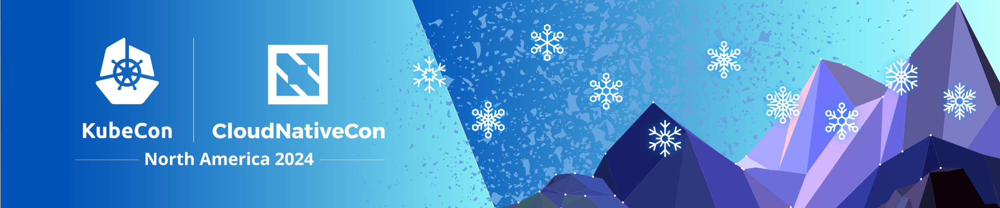

Helm буде присутній на KubeCon / CloudNativeCon North America в Солт-Лейк-Сіті. Щодня під час основної частини конференції відбуватимуться різні події, зокрема:<!-- truncate -->

* Середа:
  * Присутність на стенді в павільйоні проєктів з 3:15pm до 8pm.
  * О 7pm MST ми плануємо наживо зробити реліз.
* Четвер:
  * Присутність на стенді в павільйоні проєктів з 1:45pm до 5pm.
  * Сесія: [Contribfest: Helm 4: Наступне покоління менеджера пакунків для Kubernetes](https://kccncna2024.sched.com/event/1howt)
  * Сесія: [Шлях до Helm 4](https://kccncna2024.sched.com/event/1hoxU)
* Пʼятниця:
  * З 12:30pm до 2:30pm у павільйоні проєктів

Якщо ви хочете поспілкуватися із супровідником, щоб дізнатися більше про Helm або залишити свої відгуки, павільйон проєктів — це ідеальне місце для цього. Якщо вас цікавить Helm v4, сесія "Шлях до Helm 4" надасть огляд. А якщо ви хочете зробити свій перший внесок у Helm, сесія Contribfest стане гарним стартом.

Якщо ви будете в Солт-Лейк-Сіті, сподіваємось побачити вас там.
